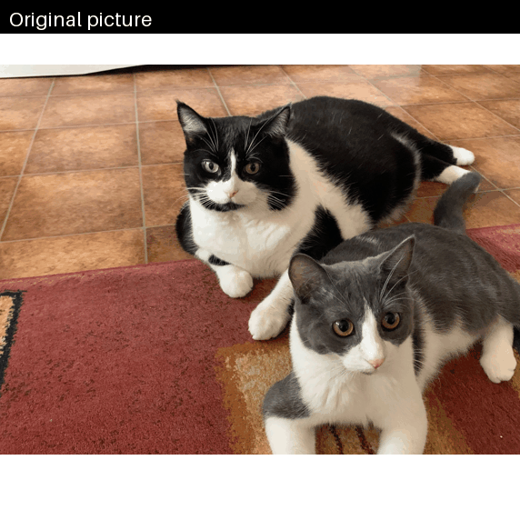

# Context and Introduction

This work is an implementation of a U-net, introduced in the following article : "U-Net: Convolutional Networks for Biomedical Image Segmentation". This model has been trained on the Oxford-IIIT dataset, containing labeled dogs and cats  pictures, for a segmentation task.



## Architecture
The implemented U-Net architecture follows the one from the article, with 3 output classes :

```python
UNet(
  (block1): Sequential(
    (0): Conv2d(3, 64, kernel_size=(3, 3), stride=(1, 1))
    (1): ReLU()
    (2): Conv2d(64, 64, kernel_size=(3, 3), stride=(1, 1))
    (3): ReLU()
  )
  (block2): Sequential(
    (0): MaxPool2d(kernel_size=(2, 2), stride=2, padding=0, dilation=1, ceil_mode=False)
    (1): Conv2d(64, 128, kernel_size=(3, 3), stride=(1, 1))
    (2): ReLU()
    (3): Conv2d(128, 128, kernel_size=(3, 3), stride=(1, 1))
    (4): ReLU()
  )
  (block3): Sequential(
    (0): MaxPool2d(kernel_size=(2, 2), stride=2, padding=0, dilation=1, ceil_mode=False)
    (1): Conv2d(128, 256, kernel_size=(3, 3), stride=(1, 1))
    (2): ReLU()
    (3): Conv2d(256, 256, kernel_size=(3, 3), stride=(1, 1))
    (4): ReLU()
  )
  (block4): Sequential(
    (0): MaxPool2d(kernel_size=(2, 2), stride=2, padding=0, dilation=1, ceil_mode=False)
    (1): Conv2d(256, 512, kernel_size=(3, 3), stride=(1, 1))
    (2): ReLU()
    (3): Conv2d(512, 512, kernel_size=(3, 3), stride=(1, 1))
    (4): ReLU()
  )
  (bridge): Sequential(
    (0): MaxPool2d(kernel_size=2, stride=2, padding=0, dilation=1, ceil_mode=False)
    (1): Conv2d(512, 1024, kernel_size=(3, 3), stride=(1, 1))
    (2): ReLU()
    (3): Conv2d(1024, 1024, kernel_size=(3, 3), stride=(1, 1))
    (4): ReLU()
    (5): ConvTranspose2d(1024, 512, kernel_size=(2, 2), stride=(2, 2))
  )
  (block5): Sequential(
    (0): Conv2d(1024, 512, kernel_size=(3, 3), stride=(1, 1))
    (1): ReLU()
    (2): Conv2d(512, 512, kernel_size=(3, 3), stride=(1, 1))
    (3): ReLU()
    (4): ConvTranspose2d(512, 256, kernel_size=(2, 2), stride=(2, 2))
  )
  (block6): Sequential(
    (0): Conv2d(512, 256, kernel_size=(3, 3), stride=(1, 1))
    (1): ReLU()
    (2): Conv2d(256, 256, kernel_size=(3, 3), stride=(1, 1))
    (3): ReLU()
    (4): ConvTranspose2d(256, 128, kernel_size=(2, 2), stride=(2, 2))
  )
  (block7): Sequential(
    (0): Conv2d(256, 128, kernel_size=(3, 3), stride=(1, 1))
    (1): ReLU()
    (2): Conv2d(128, 128, kernel_size=(3, 3), stride=(1, 1))
    (3): ReLU()
    (4): ConvTranspose2d(128, 64, kernel_size=(2, 2), stride=(2, 2))
  )
  (block8): Sequential(
    (0): Conv2d(128, 64, kernel_size=(3, 3), stride=(1, 1))
    (1): ReLU()
    (2): Conv2d(64, 64, kernel_size=(3, 3), stride=(1, 1))
    (3): ReLU()
    (4): Conv2d(64, 3, kernel_size=(1, 1), stride=(1, 1))
  )
)
```

This model is close to **31 milion parameters**, and has a size of approximatively **124 MB** once saved.

> Note: the skip connections *(see the forward method definition and the original article)* explain why the input and output features doesn't match in blocks 5-8.

## Data
It is composed of images with variables dimensions, and each of them is transformed in order to fit in other model :
1. Convert images in RGB (to fit with 3 input layers)
2. Resizing images to expected input $(388 \times 388 \text{px})$
3. Convert images to  tensors
4. Padding images *(with mirroring)* to have an output covering the whole original image $(388 \times 388\text{px})$


*Figure 1: Preprocessing pipeline. Images are resized to 388×388 and mirror-padded to 572×572; labels are only resized.*

> These are applied to both training and testing sets.

In the original article, a batch is a set of sub-tiles within one single training image. It allows the treatment of artbitrarily large image dimensions, considering limited ram memory in  the GPU.

In this implementation, a batch of $1$ full image is considered in order to simplify the code, since today's GPUs have enough memory.

## Training
We are dealing with a classification task :
- We are asigning a class for each pixels: in 3 features maps corresponding to the associated class, we define probability distributions, and apply decision rule in order to classify the pixels. This explains the output dimensions: $(n_{\text{batch}}, n_{\text{classes}}, H, W)$


*Figure 2: visualization of the forward pass outputs before decision rule.*

From these probability distributions, we can apply a decision rule, in order to obtain the mapping of these classes on the original image *(see fig.1)*. Here the decision rule is simply the maximum probability per pixel, for the given classes.

Since we are dealing with a classification task, we will consider a **Cross Entropy Loss** :

After applying a softmax $p_k : x \to [0, 1]$ in order to convert the logits in probabilities : 
$$
p_k(x) = \frac{exp(a_k (x))}{\sum_{k'=1}^K exp(a_{k'}(x))}
$$
With : 
- $a_k(x)$ : activation feature for a given pixel $x \in \Omega$, for a given class $k$ (border, background, pet).

Then define the log loss:
$$
E = - \sum_{x \in \Omega} w(x) \text{log}(p_{l(x)}(x))
$$
with:
- $l(x): \Omega \to \{1, ..., K \}$, a mapping of each pixel $x$ to the associated ground truth
- $p_{l(x)}$: the predicted probability of the ground truth $k$
- $w(x) : \Omega \to \mathbb R$, a weight map introduced to give importance to some pixels during the training, especially useful to learn the borders (seee the article for more info).

> w(x) haven't been added yet to train the model. Will be done in the next update.


 The training has been done with a **NVIDIA GeForce RTX 5060** with 8 GB of VRAM.

## Evaluation
The model was trained for 30 epochs and has been evaluated on the test set :

Of course, the notion of classification doesn't exist before our decision rule. The final decision takes as input all the probability distribution features maps  (outputs of the model, one output for each class predictions), and merges them into one single map, with one class decision per pixel (in this work we used the argmax function).

We can then define for each class:
- $TP_c$: predicted $c$, truly $c$
- $FP_c$: predicted $c$, truly another class
- $FN_c$: predicted another class, truly $c$
- $TN_c$: neither predicted nor labelled $c$


We compute the pixel accuracy (proportion of correctly classified pixels), defined for a multi class classification problem:
$$
acc = \frac{\sum_c TP_c}{\sum_c (TP_c + FP_c)} = \frac{\sum_c TP_c}{N}
$$
With $N$ the number of pixels on the final feature map (after applying the decision rule).

We compute as well the IOU, which measures for a given class $c$ the overlap between the predicted region and the true region:
$$
IOU_c = \frac{|\text{pred}_c \cap \text{true}_c|}{|\text{pred}_c \cup \text{true}_c|} = \frac{TP_c}{TP_c + FP_ c + FN_c}
$$


| Metric               | Value |
|----------------------|-------|
| Pixel accuracy       | 0.885 |
| IoU – pet            | 0.790 |
| IoU – background     | 0.870 |
| IoU – border         | 0.534 |
| Mean IoU             | 0.731 |


## Sources :
*U-Net: Convolutional Networks for Biomedical Image Segmentation* original article : https://arxiv.org/abs/1505.04597

*Dataset Oxford IIIT* : https://www.robots.ox.ac.uk/~vgg/data/pets/